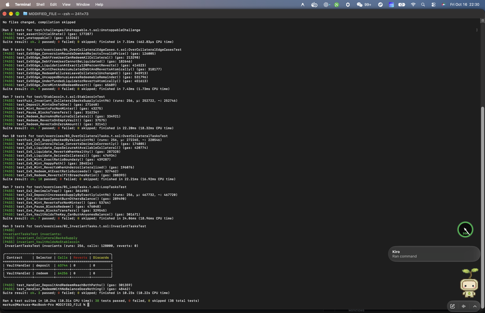
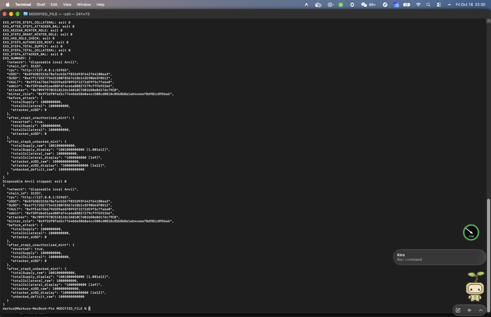
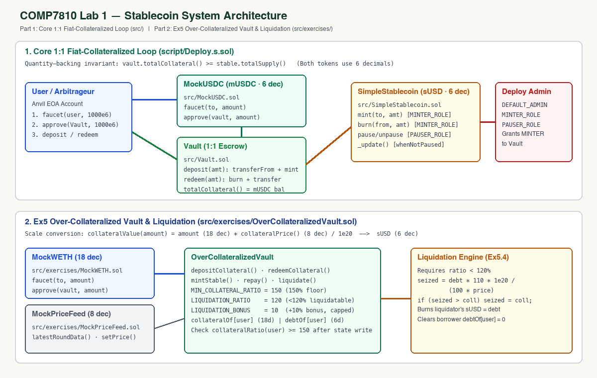
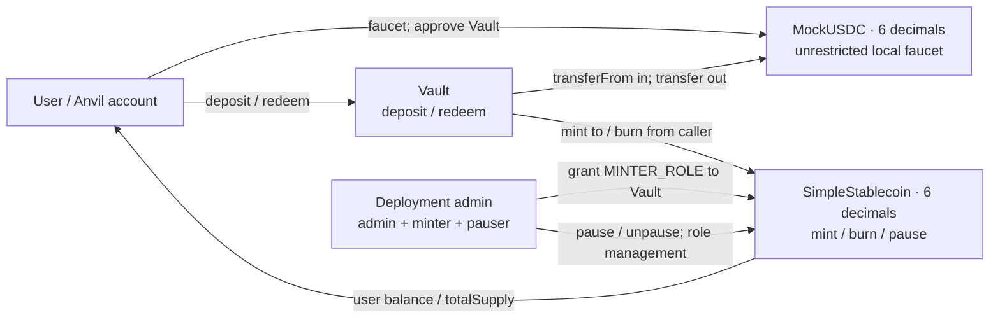
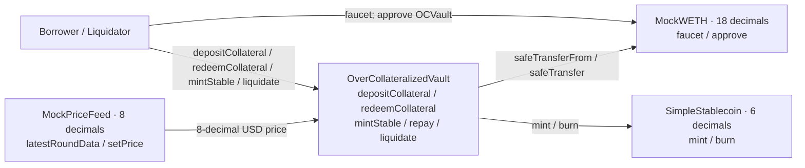

# Lab 1 — How to Create a Stablecoin

> **Completion status.** All local suites pass: `make test` (7), `make exercise` (29),
> `make challenge` (2), and unfiltered `forge test` (38 passed, 0 failed). Ex0-Ex6,
> the local Ex3 demonstration, optional Ex7, and the Sepolia deployment are complete.
> Etherscan shows verified source for all three deployed contracts: `Vault` is an Exact
> Match; `MockUSDC` and `SimpleStablecoin` are Similar Matches with runtime bytecode
> independently matching the local compilation. This is an educational prototype,
> not an audited or production-ready stablecoin.

In this lab you build a **fiat-collateralized stablecoin** from scratch: deposit collateral to mint, burn to redeem, fully backed at every moment.

The core claim, up front:

> A stablecoin's "stability" does not come from the ERC-20 code — it comes from the **mint-redeem loop**.
> ERC-20 is only a bookkeeping format; anyone can write one in ten minutes. The real work is designing the loop and the permissions around it.

---

## Submission files and evidence

- **Repository:** [markusliu04/stablecoin-lab-2026](https://github.com/markusliu04/stablecoin-lab-2026).
- [Main submission PDF](submission/COMP7810_Assignment2_Submission.pdf) contains the repository link, deployment links, screenshots, architecture and discussion answers.
- [Standalone appendix PDF](submission/COMP7810_Assignment2_Generative_AI_Appendix.pdf) is the print version of the single contribution statement linked below.
- [Submission report](submission/REPORT.md), [discussion answers](STUDENT-QUESTIONS.md), [deployment summary](submission/sepolia-deployment-summary.json), and [independent public-chain readback](submission/SEPOLIA_PUBLIC_VERIFICATION.json).
- Based on the [course starter](https://github.com/hgwoops/stablecoin-lab-2026/tree/971ae77107f750153208c495bb000673c9560403).

### Full test suite - native Terminal screenshot



### Ex3 - native Terminal screenshot



### Architecture diagram



---

## 1. Setup

Pick the track that matches your machine. **Everything after this section is identical for everyone.**

| You are on | Track |
|---|---|
| macOS / Linux | **A** — install Foundry locally |
| Windows | **B** — Codespaces, nothing installed on your machine |

> `lib/` (`forge-std`, `openzeppelin-contracts`) **ships inside this repository**.
> Neither track needs `git clone --recursive`, and neither needs `make setup` —
> a plain clone compiles as-is.

### Track A — macOS / Linux

**Step 1. Install Foundry**

First check whether you already have it:

```bash
forge --version
```

If that prints a version, skip to Step 2. Otherwise install it with the script in this repo (**do not use `foundryup`**):

```bash
bash scripts/install-foundry-cn.sh
```

The script detects your platform (macOS ARM / Intel, Linux x86_64 / arm64), tries GitHub directly, and falls back to the `gh-proxy.com` mirror. Add the line it prints to `~/.zshrc` or `~/.bashrc`, then reopen your terminal:

```bash
export PATH="$PATH:$HOME/.foundry/bin"
```

> ⚠️ **Why not `foundryup`**: its 108 MB release download goes through GitHub's CDN,
> which measured ~33 KB/s from mainland China and times out reliably
> (`Operation timed out (os error 60)`). The mirror measured ~3 MB/s — 37 seconds.

**Step 2. Get the code**

```bash
git clone https://github.com/markusliu04/stablecoin-lab-2026 && cd stablecoin-lab-2026
```

Then go to **Verify** below.

### Track B — Windows (Codespaces)

Foundry has **no native Windows binary** — the official releases ship only macOS and Linux
builds, so `scripts/install-foundry-cn.sh` will refuse to run for you, and Git Bash /
PowerShell are not workarounds. The straightforward path is to run the lab on GitHub's
servers from your browser. Nothing is installed locally, which also makes it the only
option on locked-down corporate machines.

1. Open <https://github.com/markusliu04/stablecoin-lab-2026>
2. Green **`Code`** button → **`Codespaces`** tab → **`Create codespace on main`**
3. **The first launch takes 2–5 minutes**: it builds the environment from `.devcontainer/`,
   then automatically runs `make doctor` — you should see a row of `✓` in the terminal
4. In the terminal at the bottom, run:

```bash
make test
```

`7 passed; 0 failed` means you are set.

The free tier is 120 core-hours/month (≈ 60 real hours on a 2-core machine), far more than
this lab needs. **Stop it when you are done** at <https://github.com/codespaces> — a running
Codespace keeps burning quota.

> If you would rather have a local environment on Windows, install **WSL2 + Ubuntu** and then
> follow Track A inside it. That is a one-time configuration (enable virtualization in BIOS,
> enable "Virtual Machine Platform", one admin elevation), after which it is as fast as Linux.

### Verify (both tracks)

```bash
make doctor
```

In about 30 seconds this tells you whether the machine is ready for class: it checks the
toolchain, the dependencies, and actually runs the core tests. Anything marked `✗` comes with
the exact command to fix it.

All green means you can start. **If you cannot fix it, paste the entire `make doctor` output to the TA.**

---

## 2. Quick start

```bash
make doctor        # environment check — all green before you go on
make test          # Ex0 checkpoint: core tests, should be all green (7 passed)
make exercise      # required exercise acceptance; the starter copy is deliberately red
make anvil         # terminal A: start a local chain
make deploy-anvil  # terminal B: deploy to it
```

Deployment prints three addresses — write them down (they are referred to below as `$USDC`,
`$SUSD`, `$VAULT`). For the full set of minting, balance-checking and on-chain commands, see
Ex1 and Ex3 in `EXERCISES.md`.

**Your task list lives in `EXERCISES.md`** — every exercise's goal, acceptance command, and
where to look when you get stuck.

---

## 3. What the three contracts do

| File | Role |
|---|---|
| `src/MockUSDC.sol` | **The collateral.** A mock USDC: 6 decimals, with a test faucet |
| `src/SimpleStablecoin.sol` | **The stablecoin itself.** ERC-20 + `MINTER_ROLE` (who may mint) + `PAUSER_ROLE` (whether transfers are frozen) |
| `src/Vault.sol` | **The loop.** Deposit collateral to mint 1:1; burn to take collateral back |

### Architecture (Core 1:1 Loop & Ex5 Over-Collateralized System)





`script/Deploy.s.sol` deploys the 1:1 loop (`MockUSDC`, `SimpleStablecoin`, `Vault`) and grants `MINTER_ROLE` to `Vault` — **skip that step and every deposit reverts**. The separate Ex5 system combines `OverCollateralizedVault`, 18-decimal `MockWETH`, the 8-decimal `MockPriceFeed`, and 6-decimal `sUSD` (`collateralValue(amount) = amount * collateralPrice() / 1e20`, 150% minimum collateral ratio, <120% liquidation threshold, and 10% liquidation bonus capped at `collateralOf[user]`).

#### Normal Loop (Ex1) vs. Simulated Role-Compromise & Vault Challenge (Ex3 & Ex7)

1. **Normal 1:1 Mint/Redeem Loop (Ex1):**
   - The quantity-backing invariant is **`vault.totalCollateral() >= stable.totalSupply()`**.
   - On a clean local Anvil deployment, after `faucet(user, 1000e6)` and `approve(vault, 1000e6)`, calling `vault.deposit(1000e6)` (`make mint AMOUNT=1000000000`) sets `vault.totalCollateral() = 1000000000` (`1,000` mUSDC), `stable.totalSupply() = 1000000000` (`1,000` sUSD), and `stable.balanceOf(user) = 1000000000`. Calling `vault.redeem(1000e6)` burns `1000e6` sUSD from `msg.sender` and returns `1000e6` mUSDC, restoring `totalCollateral() == totalSupply() == 0`.
2. **Local Role-Compromise & Unbacked-Mint Demonstration (Ex3):**
   - Before holding `MINTER_ROLE`, an external account (`0x7099...79C8`) calling `stable.mint(attacker, 1000000000000)` reverts with `AccessControlUnauthorizedAccount(attacker, MINTER_ROLE)`; `totalSupply()` and `totalCollateral()` remain equal (`1000000000 [1e9]`).
   - After the admin grants `MINTER_ROLE` to `attacker` (`grantRole(keccak256("MINTER_ROLE"), attacker)`), repeating `stable.mint(attacker, 1000000000000)` succeeds without passing through `Vault.deposit`.
   - Readback confirms **`stable.totalSupply() = 1001000000000 [1.001e12]`** (`1,001,000` sUSD) while **`vault.totalCollateral() = 1000000000 [1e9]`** (`1,000` mUSDC). Because `SimpleStablecoin.mint` only checks `onlyRole(MINTER_ROLE)` and has no link to `Vault` reserve balances, a compromised or misassigned `MINTER_ROLE` breaks the quantity-backing guarantee without modifying a single line of contract code.
3. **Vault Accounting Challenge (`UnstoppableVault`, Ex7):**
   - `UnstoppableVault.totalAssets()` reads `IERC20(asset()).balanceOf(address(this))`, and `flashLoan()` requires `convertToShares(totalSupply()) != balanceBefore` not to hold (`InvalidBalance()`).
   - In `test_unstoppable()`, transferring `INITIAL_PLAYER_TOKEN_BALANCE` (`10e18` DVT) directly to `address(vault)` increases `totalAssets()` to `1_000_010e18` without minting shares (`totalSupply() == 1_000_000e18`), permanently breaking the strict equality check in `flashLoan()`. When `monitor.checkFlashLoan(100e18)` runs in `_isSolved()`, `flashLoan()` reverts into the monitor's `catch` block, which emits `FlashLoanStatus(false)`, pauses the vault (`vault.paused() == true`), and transfers ownership back to `deployer`.

These counts do not prove a dollar market peg or that redemption is currently available.
`MockUSDC` has no real reserve value, and the core contract intentionally preserves the
broad mint/burn permission and all-balance-change pause behavior discussed in Ex4.

---

## 4. Homework

### Tier 1 (required) — Ex0–Ex6 in `EXERCISES.md`

1. **Ex0 Environment**: `make doctor` all green → `make test` all green (7 passed)
2. **Ex1 The loop**: run it once from the command line — faucet mUSDC → `approve` → `deposit`
   to mint → `redeem` to get collateral back
3. **Ex2 Decimals trap**: write the two `test_Ex2_*` tests in `test/exercises/01_LoopTasks.t.sol`
4. **Ex3 Break the peg yourself**: use `cast` on local Anvil to verify non-minter revert, grant
   `MINTER_ROLE` to the test attacker account, mint `1000000000000` raw sUSD, and record
   `totalSupply() >> totalCollateral()` (`1001000000000 >> 1000000000`)
5. **Ex4 Permissions and pausing**: write the five `test_Ex4_*` tests in the same file
6. **Ex5 Over-collateralization + liquidation**: fill in the four TODOs in
   `src/exercises/OverCollateralizedVault.sol` until `test/exercises/03_OverCollateralTasks.t.sol`
   is green
7. **Ex6 Invariant testing**: implement the handler's `redeem` and write two `invariant_*` tests
8. Answer the discussion questions in `STUDENT-QUESTIONS.md`

> Tier 1 does **not** require deploying to a testnet — a local Anvil is enough.
> Verify all test suites with `make test`, `make exercise`, `make challenge`, and `forge test`.

### Tier 2 (bonus / 20% — completed & verified on Sepolia)

Deploy to the Sepolia testnet and verify the source on Etherscan; submit the contract links.

**Verified Sepolia Deployment (Chain ID `11155111`, Block `11928229`, Deployer `0x00296F9fb632d058465Cf2f03F496F47237637C2`):**

| Contract | Sepolia Address | Etherscan Verified Source Link | Deployment / Role Tx |
|---|---|---|---|
| `MockUSDC` (`mUSDC`) | `0xdB7bdC4faBE2c136896A061F905227567c5Cc307` | <https://sepolia.etherscan.io/address/0xdb7bdc4fabe2c136896a061f905227567c5cc307#code> | `0x3f41943277c41796377c064cc8508c4caa1ddb3fb1d830ae07c0ced7626d81e6` |
| `SimpleStablecoin` (`sUSD`) | `0x9Acfcc3d676c77E409E81Cf24d2766bEeEe66878` | <https://sepolia.etherscan.io/address/0x9acfcc3d676c77e409e81cf24d2766beeee66878#code> | `0xe28ba26fc205ea702e6ca618d12faa68d35b4dea3a68bb92e06d8b3f359a0b23` |
| `Vault` | `0xC940A20D69a12D8806C7d8928a99b41478f266E9` | <https://sepolia.etherscan.io/address/0xc940a20d69a12d8806c7d8928a99b41478f266e9#code> | `0x8930288dd342d6bf44621056ee129757a85c4f15cc9e6e0dd4dffc206627b189` |
| `grantRole(MINTER_ROLE, Vault)` | `0x9Acfcc3d676c77E409E81Cf24d2766bEeEe66878` | <https://sepolia.etherscan.io/tx/0xa95d12fe61ff189f09f81ffd19d7c2c3aff4097b56207b5e3d5d39777a5225fb> | `0xa95d12fe61ff189f09f81ffd19d7c2c3aff4097b56207b5e3d5d39777a5225fb` |

```bash
cp .env.example .env    # fill in private key, RPC URL, Etherscan API key
source .env
forge script script/Deploy.s.sol:Deploy \
  --rpc-url $SEPOLIA_RPC_URL --broadcast --verify --gas-estimate-multiplier 800
```

**`--verify` needs `ETHERSCAN_API_KEY`** — free and takes seconds at
<https://etherscan.io/myapikey>. Leaving it empty still deploys fine: the contracts go on-chain
and only the verification step errors. **Do not redeploy because of it** — verify afterwards:

```bash
# one run per contract, with its own address and source file
forge verify-contract <address> src/SimpleStablecoin.sol:SimpleStablecoin \
  --chain sepolia --etherscan-api-key $ETHERSCAN_API_KEY
```

⚠️ Use a **fresh throwaway wallet** holding test ETH only. The private key must stay in `.env`,
which is already listed in `.gitignore` — **committing a private key scores zero**.

Sepolia test ETH: <https://cloud.google.com/application/web3/faucet/ethereum/sepolia>

### Tier 3 (challenge, optional)

Pick one:

- **Ex7 · Take the vault down (completed)**: `make challenge` (`test/challenges/Unstoppable.t.sol`,
  ported from Damn Vulnerable DeFi v4). Both `test_assertInitialState` and `test_unstoppable` pass.
- **Peg Stability Module (PSM)**: add a 1:1 swap channel against another stablecoin, so that
  arbitrageurs pull the price back to peg for you.
- **Tighten the burn permission**: remove the centralization risk that the vault can burn
  anyone's balance — the code version of question A1 in `STUDENT-QUESTIONS.md`.
- **Wire in real Chainlink**: replace `MockPriceFeed` with Sepolia's `AggregatorV3Interface`.
  Read `decimals()` first; do not hardcode 8.

---

## 5. Common problems

**`Ownable` / role errors**
OpenZeppelin v5 has breaking changes, so v4 tutorials from the web will fail. This repo pins
`v5.0.2` — do not upgrade it.

**`ds-test/test.sol` not found, or `lib/` is empty**
`lib/` is bundled with the repo, so a normal `git clone` never hits this. You probably modified
`lib/`, or unzipped an archive without the directory. Restore it:

```bash
git checkout -- lib
```

**`deposit` keeps reverting after deployment**
Nine times out of ten you skipped `stable.grantRole(stable.MINTER_ROLE(), address(vault))`.
The vault has no minting right.

**Amounts are off by an order of magnitude**
`1000e6 = 1_000_000_000` in smallest units. Both tokens have 6 decimals — do not compute with 18.

**Addresses change after restarting Anvil**
Anvil starts from a clean state every time, so you must redeploy. To keep state, use
`anvil --load-state demo-state.json`.

**`make exercise` is all red in the starter copy**
The original tests under `test/exercises/` are **deliberately red**; they are the task list.
In this completed copy, `make test`, `make exercise`, `make challenge`, and unfiltered `forge test`
all pass (38 passed, 0 failed).

**`make exercise` hangs, or an invariant failure looks strange**
Foundry stores invariant counterexamples in `cache/invariant/` and replays them on the next run.
To search for a fresh counterexample, `rm -rf cache/invariant` first.

---

## 6. Submission

| Item | Weight |
|---|---|
| Contract correctness + test coverage | 40% |
| Deployment and Etherscan verification (Tier 2) | 20% |
| Threat-model analysis (discussion questions) | 25% |
| Code style and documentation | 15% |

Submit:

1. A link to your repo (<https://github.com/markusliu04/stablecoin-lab-2026>), with native macOS Terminal screenshots and saved outputs of `forge test` passing (38 passed, 0 failed) and the Ex3 `totalSupply() >> totalCollateral()` readback
2. Tier 2: Sepolia contract addresses + Etherscan verified links:
   - `MockUSDC`: `0xdB7bdC4faBE2c136896A061F905227567c5Cc307` (<https://sepolia.etherscan.io/address/0xdb7bdc4fabe2c136896a061f905227567c5cc307#code>)
   - `SimpleStablecoin`: `0x9Acfcc3d676c77E409E81Cf24d2766bEeEe66878` (<https://sepolia.etherscan.io/address/0x9acfcc3d676c77e409e81cf24d2766beeee66878#code>)
   - `Vault`: `0xC940A20D69a12D8806C7d8928a99b41478f266E9` (<https://sepolia.etherscan.io/address/0xc940a20d69a12d8806c7d8928a99b41478f266e9#code>)
3. Your answers to the discussion questions in `STUDENT-QUESTIONS.md`
4. An architecture diagram in your README — included in Section 3 above

---

### Submitted Sepolia deployment

Network: Sepolia (`chainId = 11155111`). Deployment block: `11928229`.

| Contract | Address and verified-source link | Etherscan classification |
|---|---|---|
| MockUSDC | [0xdB7bdC4faBE2c136896A061F905227567c5Cc307](https://sepolia.etherscan.io/address/0xdb7bdc4fabe2c136896a061f905227567c5cc307#code) | Source Code Verified - Similar Match |
| SimpleStablecoin | [0x9Acfcc3d676c77E409E81Cf24d2766bEeEe66878](https://sepolia.etherscan.io/address/0x9acfcc3d676c77e409e81cf24d2766beeee66878#code) | Source Code Verified - Similar Match |
| Vault | [0xC940A20D69a12D8806C7d8928a99b41478f266E9](https://sepolia.etherscan.io/address/0xc940a20d69a12d8806c7d8928a99b41478f266e9#code) | Source Code Verified - Exact Match |

The three deployment receipts and the role-grant receipt have status `1`. Public readback
confirms that `Vault` references these collateral/stablecoin addresses and holds
`MINTER_ROLE`. No claim of three Exact Matches is made.

The contribution statement is centralized in the [Generative AI Appendix](GENERATIVE_AI_APPENDIX.md).

---

## 7. Questions left to you

These have no standard answers. They are the real point of this lab:

1. The vault holds `MINTER_ROLE`, which means it can `burn` any user's balance. Is that
   acceptable? How would you change it?
2. Pausing freezes transfers, minting and **redemption** together. What happens when you freeze
   redemption in a crisis? How should a real system be designed?
3. Under what conditions does this coin depeg? Are "insufficient collateral" and "a blocked
   redemption channel" the same class of problem?
4. If the collateral were Treasuries or real estate instead of cash, how would you write the
   `totalCollateral()` invariant?

Question 4 is the door into next week's RWA lab.
